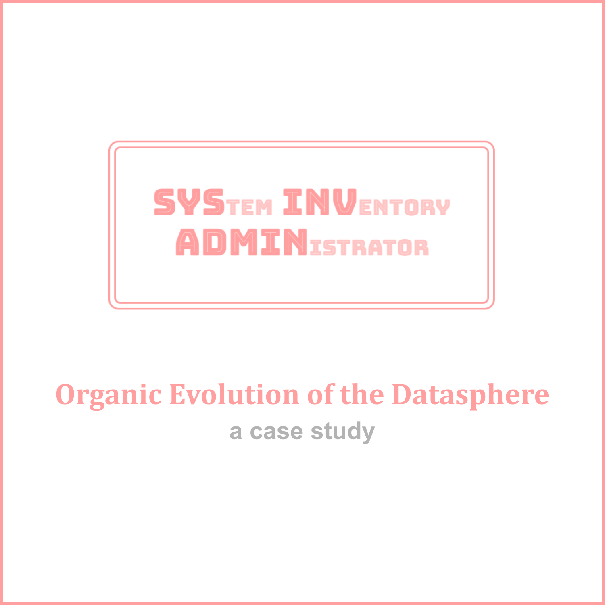

#  Organic evolution of the datasphere: a case study


## (1.) The SysInvAdmin database exists as a simple multitabular organism.
```mermaid
%%{
  init: {
    'er': {
      'diagramPadding': 40
    }
  }
}%%
erDiagram
    direction TB
    %% TABLES
    ITEMS {
        bigint id PK
        string title
        string description
        string? file_type "Type of media"
        bigint language_id FK
    }
    CATEGORIES {
        bigint id PK
        string name UK
        string? title
        string? description
        string? meta_title
        string? meta_description
        bool? hidden
    }
    LANGUAGES {
        bigint id PK
        string name "English name"
        string short_name
        string? native_name "Untranslated name"
    }
    MEDIA {
        bigint id PK
        string file_type "Arbitrary categorisation (image, thumbnail, ...)"
        string file_path
        string file_name "Original name of the file"
        string? alt
        bigint item_id FK
    }
    LINKS {
        bigint id PK
        string anchor
        string url
        bigint order "Importance of link"
        bigint item_id FK
    }
    CATEGORY_ITEM_PIVOT:::pivot {
        bigint id PK
        bigint item_id FK
        bigint category_id FK
    }

    %% RELATIONSHIPS
    %% Self-referential / Direct child links
    LANGUAGES ||--|{ ITEMS : "has"
    ITEMS ||--|{ LINKS : "has"
    ITEMS ||--|| MEDIA : "has"

    %% Pivots
    ITEMS ||--|{ CATEGORY_ITEM_PIVOT : "belongs to"
    CATEGORIES ||--|{ CATEGORY_ITEM_PIVOT : "belongs to"

    %% Styling
    classDef default fill:#ffeeee,stroke:#ff9f9f,stroke-width:4px
    classDef pivot fill:#eee,stroke:#bbb,stroke-width:3px
```
## (2.) A mutation occurs: items begin forming relationships with one another.
```mermaid
%%{
  init: {
    'er': {
      'diagramPadding': 40
    }
  }
}%%
erDiagram
    %% TABLES
    ITEMS {
        bigint id PK
        string title
        string description
        string type "Type of relationship"
        string? file_type "Type of media"
        bigint language_id FK
    }
    CATEGORIES {
        bigint id PK
        string name UK
        string? title
        string? description
        string? meta_title
        string? meta_description
        bool? hidden
    }
    LANGUAGES {
        bigint id PK
        string name "English name"
        string short_name
        string? native_name "Untranslated name"
    }
    MEDIA {
        bigint id PK
        string file_type "Arbitrary categorisation (image, thumbnail, ...)"
        string file_path
        string file_name "Original name of the file"
        string? alt
        bigint item_id FK
    }
    LINKS {
        bigint id PK
        string anchor
        string url
        bigint order "Importance of link"
        bigint item_id FK
    }
    CATEGORY_ITEM_PIVOT:::pivot {
        bigint id PK
        bigint item_id FK
        bigint category_id FK
    }
    ITEM_RELATIONSHIPS:::pivot {
        bigint id PK
        string relationship
        bigint subject_item_id FK
        bigint object_item_id FK
    }

    %% GROUPING
    subgraph Item_Core [" "]
        direction TB
        ITEMS
        ITEM_RELATIONSHIPS
        ITEMS ||--|{ ITEM_RELATIONSHIPS : "is subject"
        ITEMS ||--|{ ITEM_RELATIONSHIPS : "is object"
    end

    %% RELATIONSHIPS
    %% Self-referential / Direct child links
    LANGUAGES ||--|{ Item_Core : "has many"
    Item_Core ||--|{ LINKS : "has many"
    Item_Core ||--|| MEDIA : "has one"

    %% Pivots
    Item_Core ||--|{ CATEGORY_ITEM_PIVOT : "has many"
    CATEGORIES ||--|{ CATEGORY_ITEM_PIVOT : "has many"

    %% Styling
    classDef default fill:#ffeeee,stroke:#ff9f9f,stroke-width:4px
    classDef pivot fill:#eee,stroke:#bbb,stroke-width:3px
```
## (3.) Specialization increases: item descriptions become independent content blocks governed by a wysiwyg-editor.
```mermaid
%%{
  init: {
    'er': {
      'diagramPadding': 40
    }
  }
}%%
erDiagram
    %% TABLES
    ITEMS {
        bigint id PK
        string title
        string slug UK "Slug of title for SEO"
        string type "Type of relationship"
        string? file_type "Type of media"
        bigint language_id FK
    }
    CATEGORIES {
        bigint id PK
        string name UK
        string slug UK "Slug of name for SEO"
        string? title
        string? description
        string? meta_title
        string? meta_description
        bool? hidden
    }
    LANGUAGES {
        bigint id PK
        string name "English name"
        string short_name
        string? native_name "Untranslated name"
    }
    MEDIA {
        bigint id PK
        string file_type "Arbitrary categorisation (image, thumbnail, ...)"
        string file_path
        string file_name "Original name of the file"
        string? alt
        bigint item_id FK
    }
    LINKS {
        bigint id PK
        string anchor
        string url
        bigint order "Importance of link"
        bigint item_id FK
    }
    CATEGORY_ITEM_PIVOT ::: pivot {
        bigint id PK
        bigint item_id FK
        bigint category_id FK
    }
    ITEM_RELATIONSHIPS ::: pivot {
        bigint id PK
        string relationship
        bigint subject_item_id FK
        bigint object_item_id FK
    }
    CONTENT_BLOCKS {
        bigint id PK
        string type "Source code or quill"
        string content
        bigint contentable_id FK
        string contentable_type "Model that foreign key relates to"
    }
    
    %% GROUPING
    subgraph Item_Core [" "]
        direction TB
        ITEMS
        ITEM_RELATIONSHIPS
        ITEMS ||--|{ ITEM_RELATIONSHIPS : "is subject"
        ITEMS ||--|{ ITEM_RELATIONSHIPS : "is object"
    end

    %% RELATIONSHIPS
    %% Self-referential / Direct child links
    LANGUAGES ||--|{ Item_Core : "has many"
    Item_Core ||--o{ LINKS : "has zero or many"
    Item_Core ||--|| MEDIA : "has one"
    CONTENT_BLOCKS ||..|| Item_Core : "morphs to one"

    %% Pivots
    Item_Core ||--o{ CATEGORY_ITEM_PIVOT : "belongs to"
    CATEGORIES ||--o{ CATEGORY_ITEM_PIVOT : "belongs to"

    %% Styling
    classDef default fill:#ffeeee,stroke:#ff9f9f,stroke-width:4px
    classDef pivot fill:#eee,stroke:#bbb,stroke-width:3px
```
## (4.) Complexity breeds awareness: items dynamically define the nature of their relationships.
```mermaid
erDiagram
    direction LR
    %% TABLES
    ITEMS {
        bigint id PK
        string title
        string slug UK "Slug of title for SEO"
        bigint language_id FK
    }
    CATEGORIES {
        bigint id PK
        string name UK
        string slug UK "Slug of name for SEO"
        string? title
        string? description
        string? meta_title
        string? meta_description
        bool? hidden
    }
    LANGUAGES {
        bigint id PK
        string name "English name"
        string short_name
        string? native_name "Untranslated name"
    }
    MEDIA {
        bigint id PK
        string file_type "Arbitrary categorisation (image, thumbnail, ...)"
        string file_path
        string file_name "Original name of the file"
        string? alt
        bigint mediable_id FK
        string mediable_type
    }
    LINKS {
        bigint id PK
        string anchor
        string url
        bigint order "Importance of link"
        bigint item_id FK
    }
    CATEGORY_ITEM_PIVOT ::: pivot {
        bigint id PK
        bigint item_id FK
        bigint category_id FK
    }
    ITEM_RELATIONSHIPS ::: pivot {
        bigint id PK
        bigint relationship_id FK
        bigint subject_item_id FK
        bigint object_item_id FK
    }
    CONTENT_BLOCKS {
        bigint id PK
        string type "Source code or quill"
        string content
        bigint contentable_id FK
        string contentable_type "Model that foreign key relates to"
    }
    RELATIONSHIPS {
        bigint id PK
        string name
        string type "Hierarchical or Lateral"
        string? subject_label "Structured name from POV of subject"
        string? object_label "Structured name from POV of object"
        string? subject_descriptor "Natural name from POV of subject"
        string? object_descriptor "Natural name from POV of subject"
    }
    
    %% GROUPING
    subgraph Item_Core [" "]
        direction TB
        ITEMS
        ITEM_RELATIONSHIPS
        ITEMS ||--|{ ITEM_RELATIONSHIPS : "is subject"
        ITEMS ||--|{ ITEM_RELATIONSHIPS : "is object"
    end

    %% RELATIONSHIPS
    %% Direct child links
    RELATIONSHIPS ||--|{ Item_Core : "defines"
    LANGUAGES ||--|{ Item_Core : "has many"
    Item_Core ||--o{ LINKS : "has zero to many"
    Item_Core ||..o| MEDIA : "morphs to zero or one"
    CONTENT_BLOCKS ||..o| Item_Core : "morphs to zero or one"

    %% Pivots
    Item_Core ||--o{ CATEGORY_ITEM_PIVOT : "has many"
    CATEGORIES ||--o{ CATEGORY_ITEM_PIVOT : "has many"

    %% Styling
    classDef default fill:#ffeeee,stroke:#ff9f9f,stroke-width:4px
    classDef pivot fill:#eee,stroke:#bbb,stroke-width:3px
```
## (5.) Adaptability grows: media become an abstract container for concrete image files.
```mermaid
erDiagram
    direction LR
    %% TABLES
    ITEMS {
        bigint id PK
        string title
        string slug UK "Slug of title for SEO"
        bigint language_id FK
    }
    CATEGORIES {
        bigint id PK
        string name UK
        string slug UK "Slug of name for SEO"
        string? title
        string? description
        string? meta_title
        string? meta_description
        bool? hidden
    }
    LANGUAGES {
        bigint id PK
        string name "English name"
        string short_name
        string? native_name "Untranslated name"
    }
    MEDIA {
        bigint id PK
        string type "Arbitrary categorisation (image, thumbnail, ...)"
        bigint mediable_id FK
        string mediable_type
    }
    IMAGES {
        bigint id PK
        string path UK
        string name
        string? alt
        string mime
        bigint size "Size in bytes"
        bigint width
        bigint height
        float aspect_ratio
        bigint medium_id FK
    }
    LINKS {
        bigint id PK
        string anchor
        string url
        bigint order "Importance of link"
        bigint item_id FK
    }
    CATEGORY_ITEM_PIVOT ::: pivot {
        bigint id PK
        bigint item_id FK
        bigint category_id FK
    }
    ITEM_RELATIONSHIPS ::: pivot {
        bigint id PK
        bigint relationship_id FK
        bigint subject_item_id FK
        bigint object_item_id FK
    }
    CONTENT_BLOCKS {
        bigint id PK
        string type "Source code or quill"
        string content
        bigint contentable_id FK
        string contentable_type "Model that foreign key relates to"
    }
    RELATIONSHIPS {
        bigint id PK
        string name
        string type "Hierarchical or Lateral"
        string? subject_label "Structured name from POV of subject"
        string? object_label "Structured name from POV of object"
        string? subject_descriptor "Natural name from POV of subject"
        string? object_descriptor "Natural name from POV of subject"
    }
    
    
    %% GROUPING
    subgraph Item_Core [" "]
        direction TB
        ITEMS
        ITEM_RELATIONSHIPS
        ITEMS ||--|{ ITEM_RELATIONSHIPS : "is subject"
        ITEMS ||--|{ ITEM_RELATIONSHIPS : "is object"
    end
    subgraph Media_Core [" "]
        direction TB
        MEDIA
        IMAGES
        MEDIA ||..|{ IMAGES : "morphs to many"
    end

    %% RELATIONSHIPS
    %% Direct child links
    RELATIONSHIPS ||--|{ Item_Core : "defines"
    LANGUAGES ||--|{ Item_Core : "has many"
    Item_Core ||--o{ LINKS : "has zero to many"
    Item_Core ||..o| Media_core : "morphs to zero or one"
    CONTENT_BLOCKS ||..o| Item_Core : "morphs to zero or one"
    MEDIA ||..|{ IMAGES : "morphs to many"

    %% Pivots
    Item_Core ||--o{ CATEGORY_ITEM_PIVOT : "has many"
    CATEGORIES ||--o{ CATEGORY_ITEM_PIVOT : "has many"

    %% Styling
    classDef default fill:#ffeeee,stroke:#ff9f9f,stroke-width:4px
    classDef pivot fill:#eee,stroke:#bbb,stroke-width:3px
```
## (6.) Natural selection favors diversity: media supports multiple file types.
```mermaid
erDiagram
    direction LR
    %% TABLES
    ITEMS {
        bigint id PK
        string title
        string slug UK "Slug of title for SEO"
        bigint language_id FK
    }
    CATEGORIES {
        bigint id PK
        string name UK
        string slug UK "Slug of name for SEO"
        string? title
        string? description
        string? meta_title
        string? meta_description
        bool? hidden
    }
    LANGUAGES {
        bigint id PK
        string name "English name"
        string short_name
        string? native_name "Untranslated name"
    }
    MEDIA {
        bigint id PK
        string type "Arbitrary categorisation (image, thumbnail, ...)"
        bigint mediable_id FK
        string mediable_type
    }
    IMAGES {
        bigint id PK
        string path UK
        string name
        string? alt
        string mime
        bigint size "Size in bytes"
        bigint width
        bigint height
        float aspect_ratio
        bigint medium_id FK
    }
    VIDEOS {
        bigint id PK
        string path UK
        string name
        string? title "For SEO"
        string? description "For SEO"
        string mime
        bigint size "Size in bytes"
        bigint width
        bigint height
        float aspect_ratio
        bool has_audio
        bool loop "Video is loopable"
        string? poster_path "Poster image to use when loading"
        bigint medium_id FK
    }
    "3D_MODELS" {
        bigint id PK
        string path UK
        string name
        string? alt 
        string mime
        bigint size "Size in bytes"
        bigint triangle_count 
        json bounding_box "Bounding box of the model"
        bool has_animations "Model is animated"
        json? animation_names "Animations names that can be triggered"
        string? poster_path "Poster image to use when loading"
        bigint medium_id FK
    }
    LINKS {
        bigint id PK
        string anchor
        string url
        bigint order "Importance of link"
        bigint item_id FK
    }
    CATEGORY_ITEM_PIVOT ::: pivot {
        bigint id PK
        bigint item_id FK
        bigint category_id FK
    }
    ITEM_RELATIONSHIPS ::: pivot {
        bigint id PK
        bigint relationship_id FK
        bigint subject_item_id FK
        bigint object_item_id FK
    }
    CONTENT_BLOCKS {
        bigint id PK
        string type "Source code or quill"
        string content
        bigint contentable_id FK
        string contentable_type "Model that foreign key relates to"
    }
    RELATIONSHIPS {
        bigint id PK
        string name
        string type "Hierarchical or Lateral"
        string? subject_label "Structured name from POV of subject"
        string? object_label "Structured name from POV of object"
        string? subject_descriptor "Natural name from POV of subject"
        string? object_descriptor "Natural name from POV of subject"
    }
    
    
    %% GROUPING
    subgraph Item_Core [" "]
        direction TB
        ITEMS
        ITEM_RELATIONSHIPS
        ITEMS ||--|{ ITEM_RELATIONSHIPS : "is subject"
        ITEMS ||--|{ ITEM_RELATIONSHIPS : "is object"
    end

    %% RELATIONSHIPS
    %% Direct child links
    RELATIONSHIPS ||--|{ Item_Core : "defines"
    LANGUAGES ||--|{ Item_Core : "has many"
    Item_Core ||--o{ LINKS : "has zero to many"
    Item_Core ||..o| MEDIA : "morphs to zero or one"
    CONTENT_BLOCKS ||..o| Item_Core : "morphs to zero or one"
    MEDIA ||..|{ IMAGES : "morphs to many"
    MEDIA ||..|{ VIDEOS : "morphs to many"
    MEDIA ||..|{ "3D_MODELS" : "morphs to many"

    %% Pivots
    Item_Core ||--o{ CATEGORY_ITEM_PIVOT : "has many"
    CATEGORIES ||--o{ CATEGORY_ITEM_PIVOT : "has many"

    %% Styling
    classDef default fill:#ffeeee,stroke:#ff9f9f,stroke-width:4px
    classDef pivot fill:#eee,stroke:#bbb,stroke-width:3px
```
## (7.) Symbiosis emerges: categories and media establish independant bonds. [FUTURE UPDATE]
```mermaid
erDiagram
    direction LR
    %% TABLES
    ITEMS {
        bigint id PK
        string title
        string slug UK "Slug of title for SEO"
        bigint language_id FK
    }
    CATEGORIES {
        bigint id PK
        string name UK
        string slug UK "Slug of name for SEO"
        string? title
        string? meta_title
        string? meta_description
        bool? hidden
    }
    LANGUAGES {
        bigint id PK
        string name "English name"
        string short_name
        string? native_name "Untranslated name"
    }
    MEDIA {
        bigint id PK
        string type "Arbitrary categorisation (image, thumbnail, ...)"
        bigint mediable_id FK
        string mediable_type
    }
    IMAGES {
        bigint id PK
        string path UK
        string name
        string? alt
        string mime
        bigint size "Size in bytes"
        bigint width
        bigint height
        float aspect_ratio
        bigint medium_id FK
    }
    VIDEOS {
        bigint id PK
        string path UK
        string name
        string? title "For SEO"
        string? description "For SEO"
        string mime
        bigint size "Size in bytes"
        bigint width
        bigint height
        float aspect_ratio
        bool has_audio
        bool loop "Video is loopable"
        string? poster_path "Poster image to use when loading"
        bigint medium_id FK
    }
    "3D_MODELS" {
        bigint id PK
        string path UK
        string name
        string? alt 
        string mime
        bigint size "Size in bytes"
        bigint triangle_count 
        json bounding_box "Bounding box of the model"
        bool has_animations "Model is animated"
        json? animation_names "Animations names that can be triggered"
        string? poster_path "Poster image to use when loading"
        bigint medium_id FK
    }
    LINKS {
        bigint id PK
        string anchor
        string url
        bigint order "Importance of link"
        bigint item_id FK
    }
    CATEGORY_ITEM_PIVOT ::: pivot {
        bigint id PK
        bigint item_id FK
        bigint category_id FK
    }
    CATEGORY_MEDIUM_PIVOT ::: pivot {
        bigint id PK
        bigint medium_id FK
        bigint category_id FK
    }
    ITEM_RELATIONSHIPS ::: pivot {
        bigint id PK
        bigint relationship_id FK
        bigint subject_item_id FK
        bigint object_item_id FK
    }
    CONTENT_BLOCKS {
        bigint id PK
        string type "Source code or quill"
        string content
        bigint contentable_id FK
        string contentable_type "Model that foreign key relates to"
    }
    RELATIONSHIPS {
        bigint id PK
        string name
        string type "Hierarchical or Lateral"
        string? subject_label "Structured name from POV of subject"
        string? object_label "Structured name from POV of object"
        string? subject_descriptor "Natural name from POV of subject"
        string? object_descriptor "Natural name from POV of subject"
    }
    
    
    %% GROUPING
    subgraph Item_Core [" "]
        direction TB
        ITEMS
        ITEM_RELATIONSHIPS
        ITEMS ||--|{ ITEM_RELATIONSHIPS : "is subject"
        ITEMS ||--|{ ITEM_RELATIONSHIPS : "is object"
    end

    %% RELATIONSHIPS
    %% Direct child links
    RELATIONSHIPS ||--|{ Item_Core : "defines"
    LANGUAGES ||--|{ Item_Core : "has many"
    Item_Core ||--o{ LINKS : "has zero to many"
    Item_Core ||..o| MEDIA : "morphs to zero or one"
    CONTENT_BLOCKS ||..o| Item_Core : "morphs to zero or one"
    MEDIA ||..|{ IMAGES : "morphs to many"
    MEDIA ||..|{ VIDEOS : "morphs to many"
    MEDIA ||..|{ "3D_MODELS" : "morphs to many"
    CATEGORIES ||..o| MEDIA : "has zero or one poster image"
    CONTENT_BLOCKS ||..o| CATEGORIES : "morphs to zero or one"

    %% Pivots
    Item_Core ||--o{ CATEGORY_ITEM_PIVOT : "has many"
    CATEGORIES ||--o{ CATEGORY_ITEM_PIVOT : "has many"
    CATEGORY_MEDIUM_PIVOT }o--|| MEDIA : "has many"
    CATEGORIES ||--o{ CATEGORY_MEDIUM_PIVOT : "has many"

    %% Styling
    classDef default fill:#ffeeee,stroke:#ff9f9f,stroke-width:4px
    classDef pivot fill:#eee,stroke:#bbb,stroke-width:3px
```